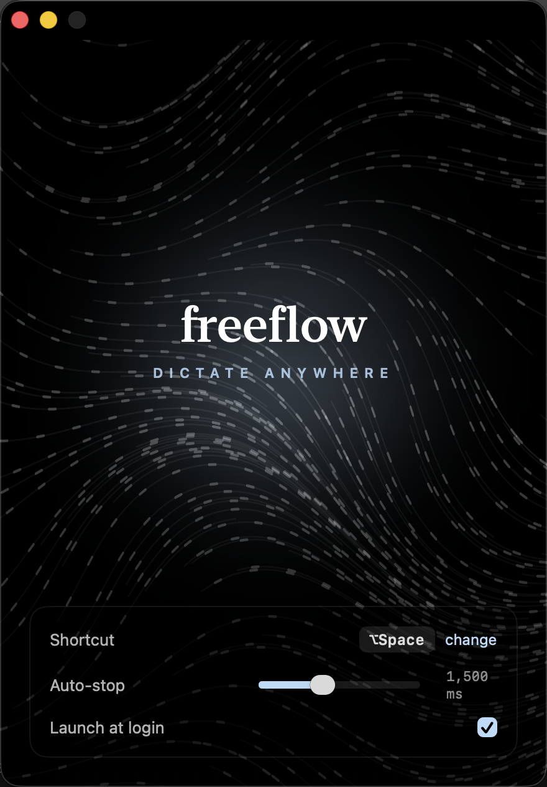

# freeflow

[](https://github.com/Olivesz/freeflow/actions/workflows/ci.yml)

A minimal, **local, free** speech-to-text-anywhere tool — a stripped-down
alternative to Wispr Flow. Tap a key, talk, and your words are typed into
whatever app has focus. Everything runs on-device (Whisper via whisper.cpp);
no account, no cloud, **$0/month**.

- **Streaming**: words appear as you speak, append-only (never un-typed).
- **Two trigger modes**: tap-to-toggle (auto-stops on silence) or hold-to-talk.
- **English by default; Simplified Chinese** in the Python app with a multilingual model (see `config.toml`).
- **One config file.** No menubar zoo of features.

<p align="center"></p>

## Setup

```bash
cd freeflow
python3.12 -m venv .venv            # already created if you ran the installer
.venv/bin/pip install -r requirements.txt
```

### Grant macOS permissions (one time)

freeflow needs three permissions for the terminal app you launch it from
(Terminal, iTerm, VS Code, …). Add that app under **System Settings → Privacy
& Security →**:

| Permission | Why | 
|---|---|
| **Microphone** | capture your voice (prompts automatically on first run) |
| **Input Monitoring** | hear the global trigger key |
| **Accessibility** | type transcribed text into other apps |

> After adding to Accessibility/Input Monitoring you must **fully quit and
> reopen** the terminal app for it to take effect.

## Use

```bash
# Validate mic + model with NO accessibility needed (records 4s, prints text):
.venv/bin/python -m freeflow check

# See your audio input devices:
.venv/bin/python -m freeflow devices

# Run the dictation daemon:
.venv/bin/python -m freeflow
```

Default trigger is **Right ⌘**. Tap it, talk, stop talking → text lands in the
focused field. Tap again to stop early. Change everything in `config.toml`.

## Configuring (`config.toml`)

Edit it like a keybind file. Highlights:

- `model.engine` — **`whisper.cpp`** (default): runs on Metal / the Neural
  Engine — fastest and coolest on Apple Silicon. `faster-whisper`: CPU backend,
  the simplest fallback.
- `model.name` — `base.en` (default) is fast and accurate for English. For
  tougher audio use `small` / `medium` / `large-v3` (slower, more accurate).
- `model.language` — `"en"`, `"zh"`, or `"auto"`. **For Chinese**, use a
  multilingual model (`small`+) with `language = "zh"` — `.en` models are
  English-only.
- `trigger.mode` — `"toggle"` or `"hold"`. `trigger.key` — e.g. `cmd_r`,
  `alt_r`, `f13`.
- `vad.silence_ms` / `stream.tick_ms` — the two latency knobs. Lower = snappier
  and streams sooner, at more CPU and slightly more risk of an early cut-off.
- `stream.inject` — `"type"` (default) or `"paste"`. **Use `"paste"` for
  Chinese**, emoji, or very long dictation.

### Speed vs. accuracy, at a glance

| Want | Set |
|---|---|
| Fastest English (default) | `engine="whisper.cpp"`, `name="base.en"` |
| More accurate English | `name="small.en"` or `"medium.en"` |
| Simplified Chinese | `name="small"` (or bigger), `language="zh"`, `inject="paste"` |
| No native deps / pure-Python | `engine="faster-whisper"` |

## How it works

```
[hotkey] → [mic 16kHz] → ┬→ [VAD: still talking?] ─────────── auto-stop
                         └→ [engine every 350ms] → [stabilize] → [type into app]
                              (trimmed window)       (LocalAgreement)
```

Three ideas do the heavy lifting, all in `freeflow/stt.py`:

1. **Append-only streaming** — Whisper revises earlier words as it hears more,
   so freeflow only types a word once *two passes agree* on it (LocalAgreement).
   Text already typed is never taken back.
2. **Buffer trimming** — instead of re-transcribing the whole utterance every
   tick (which slows down as you talk), it drops already-committed audio and
   keeps a couple seconds of context. Cost stays flat no matter how long you go.
3. **Pluggable engines** — both backends emit the same `Word` objects, so the
   whole model swaps via one config line (`model.engine`). End-of-speech
   detection lives in `freeflow/vad.py`.

## Tests

The streaming core is deliberately model-free and deterministic, so it's tested
without a mic, a model download, or any macOS permission:

```bash
.venv/bin/pip install -r requirements-dev.txt
.venv/bin/python -m pytest -q
```

Covers config merging, end-of-utterance timing (grace period, silence clock,
mid-sentence pauses), Whisper non-speech-hallucination filtering, LocalAgreement
commit semantics, and the append-only + window-trimming properties of the
streaming driver — including the coarse-timestamp boundary-repeat case that
whisper.cpp produces after a trim.
